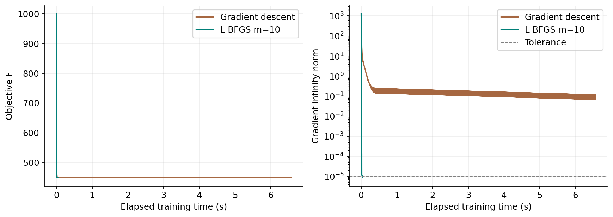

# L-BFGS for squared-hinge SVM training

This contribution implements a limited-memory BFGS optimizer and evaluates it
on the Credit Score Classification task used in the group report. It includes
the optimizer, numerical verification, a gradient-descent control, OvR training,
data-size and history-size experiments, and plotting code.

## Setup and reproduction

The recorded experiments used Python 3.9.6 on macOS ARM with one BLAS/OpenMP
thread. Python 3.9-3.12 is supported by the pinned direct dependencies.

```bash
cd L-BFGS
python3 -m venv .venv
source .venv/bin/activate
python -m pip install -r requirements.txt

# Numerical correctness checks; no dataset is needed.
python lbfgs_project.py --stage validate --output runs/validation

# Obtain and verify the exact reference archive locally.
python prepare_data.py

# Reproduce tuning, experiments, verification and figures.
python lbfgs_project.py --stage all --output runs/reproduction
```

On Windows, activate the environment with `.venv\Scripts\activate` and use
`python` for the Python commands. If the archive is already available, run
`python prepare_data.py --archive /path/to/data.zip` instead of downloading.
See [data/README.md](data/README.md) for provenance, the pinned source commit
and the expected SHA-256. Raw data remains local and is ignored by Git.

The stages can also be run separately:

```bash
python lbfgs_project.py --stage run --output runs/reproduction
python lbfgs_project.py --stage plots --output runs/reproduction
```

An explicit input is accepted with `--data /path/to/data.zip`. Use a fresh
output directory for a new run. `requirements.txt` pins direct dependencies;
`requirements-lock.txt` records the original complete package environment.

## Objective and algorithm

For each binary one-vs-rest classifier, labels are in {-1, +1} and

```text
r_i = max(0, 1 - y_i * (x_i^T w + b))
F(w,b) = 0.5 ||w||^2 + 0.5 lambda_b b^2 + C * mean_i(r_i^2)
gradient_w = w - (2C/n) X^T (y * r)
gradient_b = lambda_b b - (2C/n) sum_i(y_i * r_i)
```

The squared-hinge loss is convex and continuously differentiable, including
at unit margin, but is not twice differentiable there. With `lambda_b=0.001`,
the full objective is strongly convex. This formulation differs from an
ordinary hinge-loss SVM with an unregularized intercept; changing C alone does
not make their results directly comparable.

The code implements the objective and analytical gradients, inverse-Hessian
two-loop product, scaled-identity initialization, bounded curvature history,
curvature checks, descent checks, Armijo fallback, termination and logging.
SciPy supplies the strong-Wolfe line-search helper. The optimizer does not call
an sklearn estimator. SciPy L-BFGS-B is used separately as a numerical reference.
GD uses the same objective, line-search routine and stopping criterion.

For theta=(w,b), history pairs are `s=theta_new-theta` and `z=g_new-g`, with
`rho=1/(s^T z)` and initial scaling `(s^T z)/(z^T z)`. Only the latest m valid
pairs are stored. The stopping target is `||gradient||_inf <= 1e-5`.
Iteration limits and line-search failures are recorded separately from
successful convergence. Counts of objective/gradient evaluations include
line-search trials and use exact-point caching.

## Data protocol

The four reference CSVs combine into 29,662 records from 7,084 customers after
deduplicating record ID. Their original large train/test files share 5,575
customers, so this contribution creates a new split for unseen-customer testing.

- Seed 42 forms a customer-disjoint training pool of 20,735 rows. Seed 43
  divides the remaining customers into validation and test groups.
- Nested stratified training subsets contain 7,884 / 13,141 / 18,397 rows;
  2,338 training-pool rows are unused. Validation/test contain 4,469 / 4,458
  rows. Customer overlap across train/validation/test is zero.
- Nineteen input fields produce 28 encoded features, plus a bias parameter.
  Imputation, standardization and category encoding are fitted on training
  data only, separately for each training size.
- IDs, names and SSNs are excluded from prediction inputs. Customer ID is
  used only for splitting.
- Validation Macro-F1 on the large training subset selects C from
  `{0.01, 0.1, 1, 10, 100, 1000}`. The selected C=1000 is the upper grid
  boundary. It is the best tested grid point, not a claim of a global optimum
  over hyperparameters. C and the default m=10 are frozen before test scoring.

## Experiments and recorded results

The original aggregate CSV/JSON files, optimization traces and figures are in
[`recorded_results/`](recorded_results/). They contain no customer records,
identifiers, fitted model bundles or row-index arrays. Absolute local runtime
library paths have been removed from `environment.json`. These are the original
measured results used in the report, not the timings of a new reproduction.

### Convergence and history size

The binary Good-vs-rest benchmark uses n=18,397, 29 parameters, C=1000,
zero initialization, a 3,000-update limit and gradient tolerance 1e-5.

| Method | Updates | Evaluations | Mean time (s) | Final gradient infinity norm | Status |
|---|---:|---:|---:|---:|---|
| GD | 3000 | 30050 | 6.59864 | 1.158e-1 | Iteration limit |
| L-BFGS, m=3 | 148 | 168 | 0.03929 | 9.168e-6 | Converged |
| L-BFGS, m=10 | 64 | 171 | 0.03866 | 8.505e-6 | Converged |
| L-BFGS, m=20 | 48 | 62 | 0.01552 | 4.374e-6 | Converged |

GD does not reach the common optimization target, so the runtime ratio is not
an equal-precision speedup. More history reduces accepted updates on this
problem; line-search evaluations also contribute to runtime.



### Training size and prediction

The three-class OvR experiment uses fixed C=1000 and m=10, with at most 1,000
updates per classifier. All classifiers reach the gradient target.

| Training rows | Mean OvR time (ms) | Test accuracy | Test Macro-F1 |
|---|---:|---:|---:|
| 7,884 | 29.62 | 61.64% | 57.30% |
| 13,141 | 70.72 | 61.60% | 57.66% |
| 18,397 | 109.26 | 61.51% | 57.48% |

Time is measured inside solvers, including line search, gradients and
accepted-iterate logging; it excludes preprocessing, prediction and plotting.
OvR time sums three sequential fits. Three fixed-data repetitions give the
mean and sample standard deviation. They estimate timing variation, not
uncertainty across data splits. Execution order is fixed.

The gradient finite-difference checks, margin-boundary derivative check and
two-loop/dense-BFGS algebra check are available through `--stage validate`.
On real data, the custom and SciPy objectives agree to about 8.75e-15 relative
difference with identical binary training predictions. SciPy stops on function
reduction; its success flag does not certify the custom gradient tolerance.

## Scope and files

This is a fixed-split study with only 29 parameters. It demonstrates training
behavior on the specified objective, not a high-dimensional memory benefit or
a ranking against the group's other methods. Their losses, features, data
splits and timing scopes differ. Increasing training size does not consistently
improve test scores here.

- `lbfgs_project.py`: objective, optimizer, OvR wrapper, checks, experiments and plots.
- `prepare_data.py`: pinned reference-archive download/local copy and hash verification.
- `requirements.txt`, `requirements-lock.txt`: dependency records.
- `recorded_results/`: measured numerical evidence used in the report.
- `runs/`: ignored destination for new verification, model and experiment outputs.

To regenerate the recorded plots without training, use
`python lbfgs_project.py --stage plots --output recorded_results`.
This rewrites the figures in that snapshot directory. New complete runs also
produce a local `model.joblib`, weights and split indices, which are ignored
by Git.

## References

- [Reference SVM project and data archive](https://github.com/Cindy0725/COMP6704-Group-24-Convex-Optimization), commit `5624d97b6771cc3814a2063d151db861051976c6`.
- [Credit Score Classification dataset](https://www.kaggle.com/datasets/parisrohan/credit-score-classification).
- Nocedal (1980), *Updating Quasi-Newton Matrices with Limited Storage*. [Author's reference page](https://users.iems.northwestern.edu/~nocedal/lbfgs.html).
- Liu and Nocedal (1989), *On the limited memory BFGS method for large scale optimization*. [DOI](https://doi.org/10.1007/BF01589116).
- SciPy [strong-Wolfe line search](https://docs.scipy.org/doc/scipy-1.13.1/reference/generated/scipy.optimize.line_search.html) and [L-BFGS-B reference](https://docs.scipy.org/doc/scipy-1.13.1/reference/optimize.minimize-lbfgsb.html).
